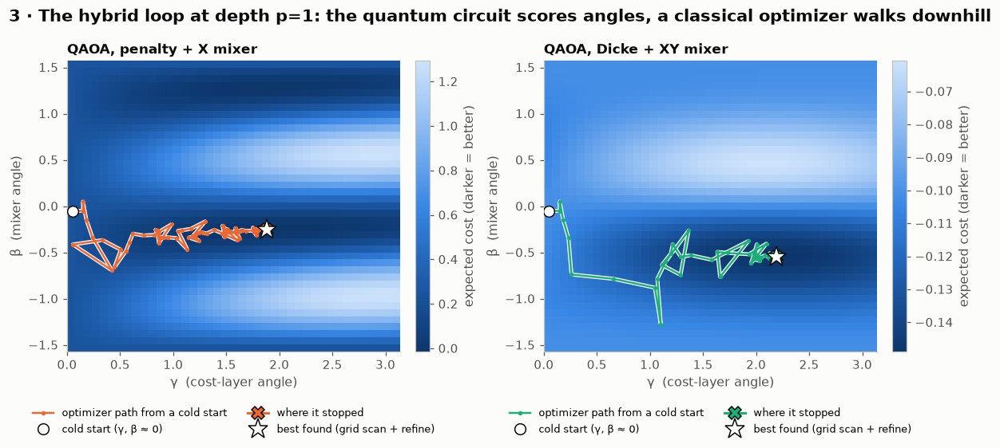
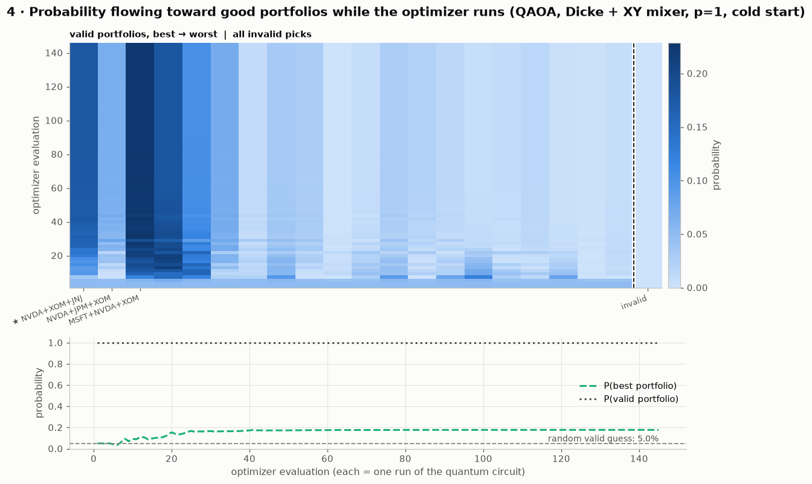
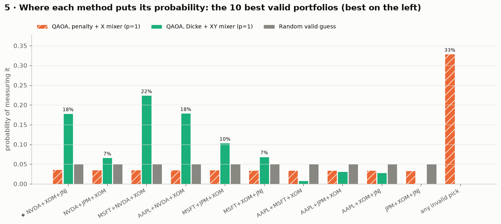
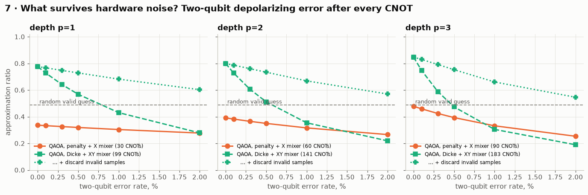

# QPort Visualizer

**See what a quantum optimizer actually does with your portfolio.** QPort solves a real
stock-picking problem three ways (exactly, with classical Markowitz, and with two designs of
the QAOA quantum algorithm) and makes every step visible: the problem as a matrix, the
hybrid quantum-classical loop walking across its energy landscape, probability flowing toward
good portfolios, what hardware noise destroys, and how the picks held up on two years of
market data the optimizers never saw.

Built in Qiskit by **Team Ortiz** (Michael Ogundeji) for the Qollab × IonQ Global Quantum
Hackathon (October 2026).
**Themes: Quantum Unlocked** (an educational tool that makes a variational algorithm
legible) **and Quantum Impact** (a real finance problem against strong classical baselines).

| | |
|---|---|
| **Run it** | Open the project on Qollab, pick a backend in **Select QPU**, press **Run**. About 25 s on a laptop. |
| **What you get** | 9 annotated figures, each with a text description and numeric tables; one job on the selected backend, compared against the simulator's prediction |
| **Honest result** | At this size classical brute force wins outright. The project shows *how* QAOA works and *which design choices* make it work, not a speedup claim. |

---

## What it shows (default run: 6 stocks, pick 3, risk aversion 3)

The best portfolio is **NVDA + XOM + JNJ**. A naive "top 3 by Sharpe ratio" pick
(MSFT + NVDA + XOM) misses it because it ignores correlation. JNJ barely moves with
NVDA (correlation 0.05).

**1. Circuit design matters more than depth.** Noiseless, from `main.py`'s own output:

| method | p | approx. ratio | P(best) | P(valid pick) | shots to see the best (99%) | CNOTs |
|---|---|---|---|---|---|---|
| Textbook QAOA (penalty + X mixer) | 1 | 0.337 | 3.6% | 67.1% | 125 | 30 |
| Textbook QAOA (penalty + X mixer) | 3 | 0.479 | 5.4% | 93.4% | 84 | 90 |
| Constraint-preserving QAOA (Dicke + XY mixer) | 1 | **0.777** | **17.8%** | 100% | **24** | 99 |
| Constraint-preserving QAOA (Dicke + XY mixer) | 3 | **0.848** | **33.0%** | 100% | **12** | 183 |
| Random valid guess | – | 0.490 | 5.0% | 100% | 90 | 0 |

The textbook recipe scores **below random guessing** among valid portfolios, because a third
of its probability lands on portfolios that break the budget. Encoding the constraint in the
circuit itself (start in a Dicke state, mix with XY gates) never breaks it, and is 3.6–6.6×
more likely than random to return the best portfolio.

**2. Noise flips the depth trade-off.** The constraint-preserving circuit has more CNOTs,
so it has more to lose:

| two-qubit error | XY p=1 | XY p=3 | penalty p=1 | XY p=1, invalid samples discarded |
|---|---|---|---|---|
| 0% | 0.777 | 0.848 | 0.337 | 0.777 |
| 0.5% | 0.569 | 0.474 | 0.320 | 0.729 |
| 2% | 0.279 | 0.190 | 0.278 | 0.603 |

With noise, the shallow circuit beats the deep one. That's why the run sends p=1 to the
backend. And because XY-QAOA can only produce an invalid portfolio through an error,
discarding those samples is a free error-mitigation step that recovers most of the loss.

**3. Out of sample (2024-01-02 to 2025-12-31):** the exact optimum returned +43.4%/yr,
Sharpe 2.05, against +37.1%/yr (Sharpe 1.62) for continuous Markowitz and +34.9%/yr
(Sharpe 1.89) for equal weights across all six. One two-year window is anecdote, not evidence
of skill. The run reports it as a sanity check on the estimates.

**4. The hardware check agrees with the simulation.** The optimized circuit (Dicke + XY,
p=1) runs as one job on the selected backend. On a noiseless simulator the measured
distribution matches the prediction to within shot noise (total variation distance
0.03–0.05 at 1,024 shots, varying run to run), and every shot is a valid portfolio.

## The figures

| # | Figure | What it teaches |
|---|---|---|
| 1 | Assets: risk vs return, correlation matrix | Why diversification needs covariance, not just Sharpe ratios |
| 2 | The QUBO matrix and all 20 valid portfolios ranked | How "pick 3 of 6" becomes an energy function on 6 qubits |
| 3 | Energy landscapes over (γ, β) with the optimizer's path | The hybrid loop: the circuit scores angles, COBYLA walks downhill |
| 4 | Probability flowing toward good portfolios, step by step | What "optimizing a quantum circuit" changes in the measured state |
| 5 | Final probability on the 10 best portfolios, per method | Penalty leakage vs a constraint-preserving circuit |
| 6 | Approximation ratio and P(best) vs depth p | What extra layers buy without noise |
| 7 | Approximation ratio vs two-qubit error, per depth | What survives hardware noise, and the free mitigation |
| 8 | Growth of $1 out of sample, plus allocations | Whether the picks held up on unseen data |
| 9 | Backend shots vs the noiseless prediction | Checking the simulation against an independent backend |









All nine figures are in [docs/figures](docs/figures).

## How to run

### On Qollab

1. Open the project and press **Run** with the **Built-in simulator** (or any local
   simulator, including the IBM noise-model ones, which show real noise in Figure 9).
2. Optionally pick an IonQ simulator in **Select QPU**. The run sends **exactly one job**
   (IonQ backends accept one per run); every other circuit evaluation runs in the browser.
3. Change any setting in the **Run settings** form, which Qollab builds from `main()`'s
   parameters:

| setting | default | meaning |
|---|---|---|
| `tickers` | `AAPL,MSFT,NVDA,JPM,XOM,JNJ` | 3–10 of AAPL, MSFT, NVDA, JPM, XOM, JNJ, WMT, NEE |
| `budget` | `3` | how many assets to hold (equal weights) |
| `risk_aversion` | `3.0` | `f(x) = risk_aversion × variance − return`; 0 chases return only |
| `max_depth` | `3` | QAOA depths p = 1..max_depth are optimized and compared (max 5) |
| `train_end` | `2023-12-31` | last day of the estimation window; later days are the out-of-sample test |
| `final_variant` | `xy` | circuit sent to the backend: `xy` (Dicke + XY) or `penalty` (textbook) |
| `final_depth` | `1` | depth of the circuit sent to the backend |
| `noise_study` | `true` | depolarizing-noise sweep (Figure 7) |
| `penalty_study` | `false` | how the textbook variant depends on its penalty weight |
| `show_figures` | `true` | draw figures (all tables and text descriptions print either way) |
| `run_on_backend` | `true` | send the one job to the selected backend |

With 8 assets the noise study sweeps fewer error rates, because density matrices grow as 4ⁿ.

### Locally

```bash
pip install -r requirements-dev.txt
python run_local.py                                  # figures are saved to out/
python run_local.py budget=2 max_depth=2 noise_study=False
python -m pytest tests/                              # 20 correctness tests
```

`run_local.py` stands in for Qollab: it injects Qiskit's `BasicSimulator` as the `backend`
and saves each figure as a PNG.

## How it works

```
data/prices.csv ──► returns μ, covariance Σ (estimation window)
                     │
                     ▼
     pick B of n:  min  f(x) = q·wᵀΣw − μᵀw ,  w = x/B
                     │
       ┌─────────────┼──────────────────────────────┐
       ▼             ▼                              ▼
  exact search   Markowitz (SLSQP,         QUBO  xᵀQx + λ(Σx − B)²
  (all C(n,B))   continuous weights)               │  x = (1 − Z)/2
       │             │                              ▼
       │             │                Ising H = Σ hᵢZᵢ + Σ Jᵢⱼ ZᵢZⱼ  (n qubits)
       │             │                              │
       │             │            ┌─────────────────┴──────────────────┐
       │             │            ▼                                    ▼
       │             │   penalty QAOA: H⊗ⁿ, then          XY QAOA: Dicke(n,B), then
       │             │   [RZZ/RZ(γ) · RX(2β)]ᵖ            [RZZ/RZ(γ) · XX+YY ring(β)]ᵖ
       │             │            └───── COBYLA tunes γ, β (hybrid loop) ─┘
       │             │                              │
       ▼             ▼                              ▼
   ground truth ── scores ── approx. ratio, P(best), noise sweep, backtest, one backend job
```

**Formulation** (`qport/problem.py`). Choosing B of n assets in equal weights gives the
objective f(x) = q·wᵀΣw − μᵀw with w = x/B. The budget constraint becomes a penalty
λ(Σxᵢ − B)². The default λ is provably large enough: any violation costs at least λ, and λ
exceeds the full range of f, so the minimum of the penalized QUBO is always a valid
portfolio. A bisection also finds the *smallest* λ that works, which the `penalty_study`
uses. Substituting xᵢ = (1 − Zᵢ)/2 gives a Hamiltonian of Z and ZZ terms, normalized so the
largest QUBO coefficient is 1.

**Two QAOA designs** (`qport/qaoa.py`).
- *Penalty + X mixer* (Farhi et al. 2014): the textbook recipe, starting from |+⟩⊗ⁿ.
- *Dicke + XY mixer* (Hadfield et al. 2019, "Quantum Alternating Operator Ansatz"): starts
  in the Dicke state, an equal superposition of exactly the C(n,B) valid portfolios. A
  parity-ordered ring of XX+YY gates only swaps one asset in for one out, so the state never
  leaves the valid subspace and the cost needs no penalty.
- *Preparing the Dicke state:* we compile two exact circuits and keep the one with fewer
  CNOTs. Generic state synthesis wins on small registers; the deterministic O(n·B) circuit of
  Bärtschi & Eidenbenz (2019) wins from 8 qubits on:

  | Dicke(n, B) | generic synthesis | Bärtschi–Eidenbenz |
  |---|---|---|
  | (4, 2) | **11** | 24 |
  | (6, 3) | **57** | 62 |
  | (8, 4) | 247 | **118** |
  | (10, 5) | 1,013 | **192** |

Cost layers are explicit RZZ/RZ gates: all terms commute, so this is the exact cost unitary,
and Qollab's circuit panel shows every gate.

**The hybrid loop.** COBYLA minimizes the expected cost. Angles are bounded to one period
window (γ ∈ [0, π], β ∈ [−π/2, π/2]; β has period π for both mixers). At p=1 the optimizer
refines from the three lowest basins of a 41×41 landscape scan plus a cold start, and keeps
the best. Each deeper level starts from the INTERP extrapolation of the previous optimum
(Zhou et al. 2020). The cold start (tiny γ > 0, β < 0) follows the adiabatic direction for
these gate conventions, and is what Figures 3–4 animate.

**Simulation, and how it is checked.** Inside the loop, circuits run on a small exact numpy
statevector kernel built from Qiskit's own gate matrices, 13–50× faster than simulating
the bound circuit with `Statevector` on every evaluation (0.2–0.6 ms vs 3–14 ms at 6 qubits).
That speed is what makes a 41×41 landscape and thousands of optimizer steps practical in a
browser. It is checked on every run
against `qiskit.quantum_info.Statevector` on the real circuit (agreement better than 10⁻¹⁵).
The tests also check it against Qiskit's `StatevectorEstimator` and against Qiskit's library
`qaoa_ansatz`.

**Noise model** (`qport/noise.py`). Each optimized circuit is compiled to CX + U and
simulated as a density matrix, with two-qubit depolarizing error e₂ after every CNOT and
e₂/10 after every single-qubit gate. The sweep covers e₂ = 0–2%, the range of published
two-qubit error rates on current hardware. A fast tensor kernel does the work. It is tested
against `qiskit.quantum_info.DensityMatrix` with Kraus channels. The model is deliberately
simple and transparent; it is not a device emulator.

**Metrics.** *Approximation ratio* = (f_worst − E[f]) / (f_worst − f_best) over valid
portfolios, where invalid outcomes count as the worst valid one, so breaking the constraint
is never rewarded. *Shots for 99%* = how many samples you need to see the best portfolio at
least once with 99% probability.

## Verification

`tests/test_qport.py` (20 tests) checks every claim above:
- the QUBO and the Ising Hamiltonian agree on every bitstring
- the penalized minimum is the constrained optimum, and too small a penalty is rejected
- both Dicke preparations are exact, and the selector never picks the costlier one
- the XY mixer never leaves the valid subspace, for random angles at p=1..3
- the statevector kernel matches `Statevector`, `StatevectorEstimator` and Qiskit's `qaoa_ansatz`
- the noise kernel matches `DensityMatrix` with Kraus channels, and is exact at zero noise
- the counts bitstring decodes to the right assets on a Qiskit backend
- the backtest arithmetic and the Markowitz constraints hold

`tools/qollab_runtime_checks/` holds the two scripts used to verify the Qollab runtime
before building: Pyodide, Qiskit 2.5.2, one-job IonQ limit, single 12-qubit IonQ job,
plot rendering.

## Accessibility

- Every figure prints a **text description** first, and every result is also printed as a
  **plain-text table**, so the full analysis works with a screen reader or with
  `show_figures=false`.
- Colors come from a categorical palette checked with a color-vision-deficiency validator
  (lightness band, chroma, adjacent-pair separation under simulated CVD). Each method keeps
  one color everywhere, and identity never relies on color alone: markers, line styles,
  hatching and direct labels carry it too.
- Figures use dark ink on a light surface, so they stay legible on Qollab's dark editor;
  sequential maps use one hue, diverging maps two hues with a neutral midpoint.
- One y-scale per panel; units on every axis.

## Project structure

```
main.py                 Qollab entry point: main() = Run settings form; steps 1-7 + summary
qport/data.py           load the bundled CSV, train/test split, annualized μ and Σ
qport/problem.py        objective, QUBO, Ising mapping, penalty bounds, metrics
qport/classical.py      exact enumeration, naive top-Sharpe, Markowitz, backtest
qport/qaoa.py           circuits (Dicke, XY ring, RZZ cost), fast kernel, hybrid loop
qport/noise.py          depolarizing density-matrix study, post-selection
qport/viz.py            the nine figures (accessible palette, text descriptions)
qport/report.py         console narration and tables
run_local.py            run outside Qollab (BasicSimulator backend, PNG figures)
tests/test_qport.py     20 correctness tests
tools/fetch_prices.py   how data/prices.csv was downloaded
data/prices.csv         daily adjusted closes, 8 tickers, 2021-2025 (see data/README.md)
```

## Limitations

- **No quantum advantage is claimed.** 6–10 assets means at most 252 valid portfolios, which
  classical search handles instantly. QAOA's value here is as a transparent, testable
  object of study.
- The model uses equal weights within the chosen set; Markowitz is shown as the
  continuous-weight reference.
- Expected returns estimated from three years of history are noisy, so the out-of-sample
  ranking can change with `train_end`.
- The noise model is uniform depolarizing, without crosstalk, readout error or device
  connectivity.

## Credits and disclosure

- Built during the hackathon build window (Oct 9–11, 2026). No pre-existing project code
  was used.
- **AI assistance:** developed with Claude Code (Anthropic), which helped write the code,
  tests and documentation under the author's direction. Every number in this README comes
  from running the code in this repository.
- **Methods from the literature:** Farhi, Goldstone & Gutmann, *A Quantum Approximate
  Optimization Algorithm* (2014); Hadfield et al., *From the Quantum Approximate
  Optimization Algorithm to a Quantum Alternating Operator Ansatz*, Algorithms 12(2) (2019);
  Bärtschi & Eidenbenz, *Deterministic Preparation of Dicke States*, FCT 2019;
  Zhou et al., *Quantum Approximate Optimization Algorithm: Performance, Mechanism, and
  Implementation on Near-Term Devices*, PRX 10, 021067 (2020) (INTERP);
  Markowitz, *Portfolio Selection*, J. Finance (1952).
- **Software:** Qiskit (Apache 2.0), NumPy, SciPy, Matplotlib.
- **Data:** see [data/README.md](data/README.md).

## License

MIT. See [LICENSE](LICENSE).
